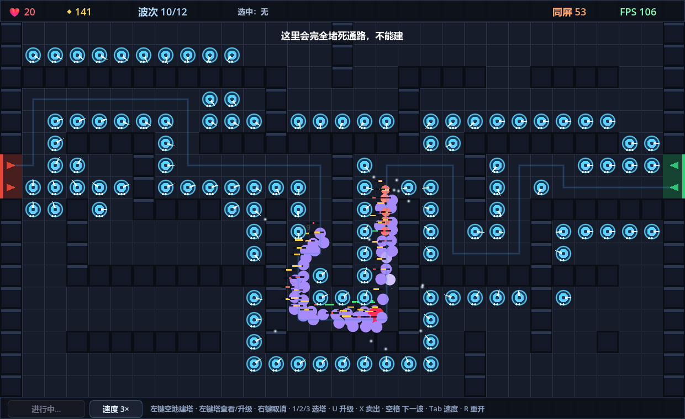

---
本工程是看到bilibili Voidmatrix UP的视频
https://www.bilibili.com/video/BV1Riak68ECd/?spm_id_from=333.1391.0.0&vd_source=23ebc69f2012a465493c3592be4fcc76
然后仅仅修改了指定游戏开发引擎，仅一次输入，使用的TRAE Code + DeepSeek-V4.1 Flash，总共耗时2H20M，积分消耗312
---
---------------指令输入开始------------------------
任务 
 在当前目录下做一个 2D 迷宫塔防游戏。敌人从地图一端出发，自己找路走向另一端。玩家建造塔来拦截。 
 
 当前目录下没有任何素材，一切图形和音效都由你自己生成。 
 
 游戏启动后立即进入地图，不出现任何界面。 
 
 一、必须实现的功能 
 敌人与寻路 
 敌人从出生点自己找路走到终点。不是沿固定折线平移，而是真的在寻路。 
 
 塔占据格子，会挡住敌人的路，敌人的路径必须因此改变、绕行。 
 
 地图是网格。哪些格子能建、哪些不能建，画面上必须能一眼看出来。 
 
 塔与战斗 
 至少 2 种塔，射程、攻速、伤害、价格各不相同。 
 
 至少 3 种敌人，速度、血量各不相同。 
 
 塔自动锁定射程内的敌人、发射子弹、造成伤害。子弹命中必须看得出来。 
 
 系统 
 波次系统：至少 8 波，一波比一波强。越往后的波次同屏敌人越多、子弹越密。 
 
 经济：击杀获得金币，建塔和升级消耗金币，收支必须分毫不差。 
 
 生命值：敌人走到终点扣命，命归零则失败。 
 
 胜负结算：撑过所有波次为胜利，命归零为失败。 
 
 性能 
 玩法要能撑起大规模同屏。在波次和玩法设计上，尽可能多地让敌人同时出现在屏幕上、尽可能多地让子弹同时在飞，并且每一个敌人都在真实寻路。 
 
 同屏规模上去之后，帧率不能明显下降，不能出现卡顿。 
 
 界面右上角常驻显示当前 FPS 和当前同屏敌人数。 
 
 把你实测到的峰值写进 交付说明.md，格式： 
 
 峰值：同屏 ___ 个敌人 + ___ 发子弹，当时 ___ FPS 
 怎么压测的：___ 
 界面 
 界面必须完整、可交互、美观。塔、敌人、子弹、特效、界面全部由你自己生成，没有现成素材。 
 
 界面必须包含以下内容： 
 
 常驻显示： 
 
 生命值 
 金币 
 当前波次 / 总波次 
 FPS 和同屏敌人数 
 当前选中的对象 
 鼠标交互： 
 
 悬停可建造格子时，格子高亮 
 左键点空格子，弹出建造菜单，列出每种塔的图标、名称、价格。金币不足的选项必须不可选 
 悬停建造菜单里的某个塔时，在场上显示这个塔的射程范围 
 左键点已有的塔，弹出信息面板，显示等级、伤害、射程、攻速，并有升级按钮和卖出按钮，各自标价 
 右键或点击空白处，关闭面板、取消选择 
 按钮： 
 
 开始下一波 
 切换游戏速度，1× / 2× / 3× 
 结算面板： 
 
 半透明遮罩盖住画面，底下的游戏画面仍然可见 
 居中显示大号胜负文字 
 下方显示统计：用时、剩余命数、总击杀、建塔数 
 最下方显示「按 R 键再来一局」 
 界面打开时游戏不暂停。敌人照走、塔照打、金币照算。 
 二、操作 
 固定使用以下键位，不得更改，不得增减。 
 
 动作 	 键位 
 移动光标 	 鼠标 
 选中格子 / 选中塔 / 点按钮 	 鼠标左键 
 取消选择、关闭面板 	 鼠标右键 
 选择要建的塔 	 1 2 3 
 升级选中的塔 	 U 
 卖出选中的塔 	 X 
 开始下一波 	 空格 
 切换速度 	 Tab，在 1× / 2× / 3× 之间循环 
 重新开始 	 R，只在结算面板上有效 
 不得出现标题界面、开场动画、暂停菜单、设置菜单。 
 
 三、技术环境 
 这台机器上装了多种语言和运行时。装了哪些、什么版本，自己查。 
 
 node --version        where node 
 python --version      where python 
 rustc --version       where rustc 
 dotnet --version      java -version 
 选你擅长的、或者最适合这个项目的语言，在 计划.md 里说明理由。 
 
 可以联网。需要额外的代码库、依赖、工具、文档、参考资料，都可以从网上下载，也可以安装到本地。访问境外站点时检查clash for windows的设置，可能需要走本地代理 http://127.0.0.1:7890，下载失败时带上代理重试。不确定的 API 和语法去查官方文档，不要靠记忆写。 
 
 下载边界：代码库和依赖随便下，美术素材、贴图、图标、字体不许下，见第四节第 3 条。 
 
 四、硬性限制 
 1. 只许用godot游戏引擎 
 
 
 提供碰撞检测、场景管理、动画补间、物理系统，属于引擎，只允许使用godot。 
 只提供把像素画到屏幕上、把声音播出来、读键盘鼠标、画文字，属于底层接口，允许。 
 允许：Canvas 2D、WebGL、Web Audio、键盘鼠标事件、SDL2、raylib、SFML、pygame、tkinter。 
 
 禁止：Unity、Unreal、Cocos、GameMaker、RPG Maker、Phaser、Kaplay，以及 Babylon 的引擎模式。 
 
 禁止：任何寻路库和路径规划库，包括 pathfinding、easystar、navmesh 这类。 
 
 渲染、碰撞、寻路、波次调度、界面事件全部自己写。 
 
 2. 不能写到当前目录外面去 
 可以读这台机器上的任何东西。不可以写、不可以改、不可以删当前目录以外的任何文件。不许改系统配置，不许装全局软件。 
 
 全部产物都留在当前目录里。 
 
 3. 美术与音效 
 没有任何现成素材。塔、敌人、子弹、特效、地图、界面全部由你自己生成，可以用代码绘制或程序化生成，也可以用 AI 生成。 
 
 不许去网上下载美术素材、贴图、精灵图、图标、字体。 
 
 4. 技术选型自由 
 C++、Python、Node.js、浏览器 JS、Rust、C# 都可以，选了就在 计划.md 里说明理由。 
 
 五、工作流程 
 1. 先写计划 
 动手写代码之前，先建 计划.md，写清楚： 
 
 一句话概括你要做的游戏。 
 技术选型，以及为什么。 
 文件结构，建哪些文件、各自负责什么。 
 上面每一条必须实现的功能，你打算怎么实现。 
 寻路方案：大量敌人同时找路，你打算怎么算。 
 性能预算：目标同屏多少敌人、多少子弹，靠什么手段扛住。 
 路被塔完全堵死时，敌人会怎么样。 
 写完计划再开始写代码。 
 
 2. 必须自测 
 能跑不算测过。交付之前，你要把它真的跑起来、自己玩过。 
 
 至少要覆盖到这几个方面： 
 
 正常流程走完整。 
 边界和异常：极限的输入、极限的数值、非法操作、连续快速的重复操作。 
 长时间运行不能崩、不能卡死、不能内存暴涨。 
 怎么测、测哪些点，你自己判断。上面是要覆盖到的方面，不是清单。 
 
 自测能写成脚本的就写成脚本，不要只靠手点。 
 
 自测用到的所有脚本、跑出来的日志、输出文件、截图，全部保留在当前目录里，不要删除。它们和源码一样是交付物。 
 
 3. 如实报告 
 自测报告.md 按下面三段写： 
 
 【已验证】<验了什么> 
     证据：<跑了什么命令 / 看到什么现象 / 实测数字是多少> 
 
 【无法验证】<没法验什么> 
     原因：<为什么验不了> 
 
 【未实现】<知道该做但没做的> 
     原因：<为什么没做> 
 无法验证的事情必须如实写出来，不允许编造。 
 
 4. 反抄袭 
 可以联网查文档、查 API 用法、查寻路算法的原理。不可以下载、复制、粘贴现成的游戏项目、游戏源码、寻路库。实现必须是你自己写的。用了第三方库或参考了公开算法，在 交付说明.md 里注明出处。 
 
 5. 启动方式 
 按你选的语言，必须交付下面其中之一： 
 
 编译型语言（C++、Rust 等）：编译出可执行文件，在 交付说明.md 里写明它的完整路径和启动方式。 
 解释型语言（Python、Java、Node.js 等）：在项目根目录提供一个名为 启动.cmd 的批处理文件，双击即可启动。 
 启动入口必须做到双击或复制粘贴一行命令就能跑起来，不需要手工配环境变量、改代码、调参数。 
 
 6. 交付物 
 文件 	 内容 
 计划.md 	 第 1 节要求的计划 
 交付说明.md 	 见下 
 完整源码 	 你写的全部代码 
 自测报告.md 	 第 2 节的自测结果 + 第 3 节的三段 
 自测脚本与产物 	 第 2 节要求保留的脚本、日志、输出文件、截图 
 交付说明.md 必须包含： 
 
 启动方式，见第 5 节。 
 依赖清单，需要装什么、怎么装。 
 操作说明，每个键、每个按钮干什么。 
 寻路方案简述，以及路被堵死时的处理。 
 实测性能峰值，按第 14 条的格式写。 
 界面清单，界面上有哪些元素、各自在哪。 
 已知问题。 
 架构简述，分几个模块、各自负责什么。 
 交付前逐条自检： 
 
 启动入口真实存在：编译型语言有可执行文件，解释型语言有 启动.cmd，双击或复制粘贴一行命令就能跑通。 
 没有硬编码的绝对路径。 
 没有把临时文件和缓存混进源码目录。自测脚本和日志要留着，但和源码分开放。 
 路被完全堵死时不崩、不卡死，敌人有合理反应。 
 每一个按钮都能用，金币不足的选项看得出来不可选。 
 金币收支分毫不差。 
 右上角的 FPS 数字和实际帧率一致，不是写死的假数字。 
 交付说明.md 里每一句「实现了 X」都能指出对应画面。 
 没有往当前目录外面写过任何东西。 
 当你认为全部做完时，在最后一条消息里单独输出一行： 
 
 === 交付完成 === 
 只有真的做完了才输出这一行。
---------------指令输入结束------------------------


# 迷宫塔防 · Maze Tower Defense

> 一个用 **Godot 4.7 + GDScript** 从零手写的 2D 网格迷宫塔防游戏。
> 敌人在迷宫里**实时寻路**走向终点，你建塔改地形、逼它们绕路。
> **没有任何现成素材**：地图、塔、敌人、子弹、特效、界面、音效全部由代码程序化生成。



---

## 目录

- [它是什么](#它是什么)
- [亮点](#亮点)
- [快速开始](#快速开始)
- [操作方式](#操作方式)
- [玩法与数值](#玩法与数值)
- [核心设计](#核心设计)
- [性能实测](#性能实测)
- [项目结构](#项目结构)
- [自测与产物](#自测与产物)
- [文档](#文档)
- [第三方与声明](#第三方与声明)

---

## 它是什么

在 31×19 的网格迷宫里，敌人从左侧出生点出发、**自己计算最短路**走向右侧终点；
玩家在可建造格上建塔，塔会**占据格子、挡住通路**，敌人的路径随之改变、绕行。
用 3 种塔拦截 4 种敌人，撑过 12 波即为胜利，生命值归零则失败。

游戏**启动后立即进入地图**：没有标题界面、没有开场动画、没有暂停菜单、没有设置菜单。

---

## 亮点

- **真寻路，不是沿固定折线平移**——用流场（Flow Field / Dijkstra 距离场）实现。建一座塔，全图所有敌人下一帧同时改道，画面上的蓝色「当前路线」提示线会实时变形。
- **每个敌人都在真实寻路，而且能上规模**——8192 个敌人和 8 个敌人的寻路开销是同一数量级：一次 Dijkstra 重建服务全体，每个敌人每帧只做一次 O(1) 数组查表。
- **面向数据的架构**——敌人/子弹/塔/特效全部用 `Packed*Array` 定长数组 + 空闲链表，没有 per-object 的 Node、没有对象分配、没有 GC 抖动。
- **GPU 实例化渲染**——所有敌人/子弹/特效用 `MultiMeshInstance2D` 一次 draw call 画完，绘制开销与数量无关。
- **经济分毫不差**——金币只用 `int`，所有收支走唯一入口并记账，恒等式 `初始 + 收入 − 支出 + 退款 == 当前金币` 实时校验。
- **零外部依赖**——无第三方库、无插件、无贴图、无字体、无音频文件。

---

## 快速开始

### 依赖

| 依赖 | 版本 | 说明 |
| --- | --- | --- |
| [Godot Engine](https://godotengine.org/) | **4.7.x**（实测 4.7.2.stable） | **唯一依赖**，渲染后端用 GL Compatibility |
| 第三方库 / 插件 | 无 | 渲染、碰撞、寻路、波次调度、界面事件全部自写 |
| 美术 / 贴图 / 图标 / 字体 / 音频 | 无 | 全部程序化生成 |

装一个 Godot 4.7+ 就行，不需要 npm / pip / cargo / dotnet。把 `godot.exe` 放进 `PATH`、或设置环境变量 `GODOT_BIN`、或放到常见的 Godot 安装目录即可。

### 启动

**双击项目根目录的 `启动.cmd`。** 或在命令行里：

```bat
cd /d <本项目目录> && 启动.cmd
```

- 没有任何编译步骤（纯 GDScript 工程）。
- 不需要手工配置环境变量、不需要改代码、不需要调参数。
- `启动.cmd` 会按 `GODOT_BIN` → `PATH` → 常见安装目录的顺序自动查找 Godot 本体，找不到时会给出明确提示。

> `启动.cmd` 启动前会把 `APPDATA` / `LOCALAPPDATA` 重定向到项目内的 `.godot_userdata\`，运行期不会在项目目录外产生文件。

---

## 操作方式

| 动作 | 键位 |
| --- | --- |
| 移动光标 | 鼠标 |
| 选中格子 / 选中塔 / 点按钮 | 鼠标左键 |
| 取消选择、关闭面板 | 鼠标右键（也可左键点空白处） |
| 选择要建的塔 | `1` `2` `3` |
| 升级选中的塔 | `U` |
| 卖出选中的塔 | `X` |
| 开始下一波 | `空格` |
| 切换速度（1× / 2× / 3× 循环） | `Tab` |
| 重新开始（只在结算面板上有效） | `R` |

**交互流程**

1. 鼠标移到可建造格 → 格子亮绿色描边；移到墙 / 已占用格 → 亮红色。
2. 左键点空格子 → 弹出建造菜单（3 种塔的图标 + 名称 + 价格 + 简介，**金币不足的行置灰且点不动**）。
3. 鼠标悬停菜单里某一项 → 场上实时画出这座塔的射程圈。
4. 点某一项建塔（也可以先按 `1/2/3` 手持一座塔，再左键点空地直接建）。
5. 左键点已有塔 → 弹出信息面板（等级 / 伤害 / 射程 / 攻速 + 升级按钮 + 卖出按钮，各自标价）。
6. 右键或左键点空白处 → 关闭面板、取消选择。

**界面打开时游戏不暂停**：建造菜单、塔信息面板、结算面板全部只切 `visible`，从不设置 `get_tree().paused`——菜单开着的时候敌人照走、塔照打、金币照算。

---

## 玩法与数值

### 塔（3 种）

| 键 | 名称 | 价格 | 射程 | 攻速 | 伤害 | 特性 | 升级价 L1→L2 / L2→L3 |
| --- | --- | --- | --- | --- | --- | --- | --- |
| `1` | 弩塔 | 50 | 116 | 1.70 /s | 11 | 单体速射 | 45 / 75 |
| `2` | 炮塔 | 110 | 138 | 0.72 /s | 30 | 溅射半径 46 | 99 / 165 |
| `3` | 冰塔 | 75 | 104 | 1.15 /s | 5 | 减速 55%，1.8s | 67 / 112 |

锁敌策略：射程内取 `dist[]` 最小者（离终点最近、最危险的那个）——天然复用流场，零额外开销。

### 敌人（4 种）

| 名称 | 生命 | 速度 (px/s) | 击杀金币 | 漏怪扣命 |
| --- | --- | --- | --- | --- |
| 游荡者 | 44 | 58 | 7 | 1 |
| 疾行者 | 30 | 104 | 6 | 1 |
| 重甲兵 | 190 | 36 | 19 | 2 |
| 首领 (Boss) | 1400 | 30 | 160 | 10 |

### 系统

- **波次**：共 **12 波**，一波比一波强——数量随波次线性放大、血量按 `1 + 0.26×(w−1)` 放大、生成间隔逐波收紧。后期单波 300+ 只，密集生成。
- **经济**：起始 **320** 金。击杀获得金币，建塔 / 升级消耗金币，卖出返还累计投入的 **70%**。收支分毫不差。
- **生命**：起始 **20** 命，敌人走到终点扣命，归零则失败。
- **胜负**：撑过 12 波为胜利（结算面板显示用时 / 剩余命数 / 总击杀 / 建塔数），命归零为失败。最下方提示「按 R 键再来一局」。

---

## 核心设计

### 1. 流场寻路（Flow Field）

**不逐敌 A\*，而是从终点反向做一次多源 Dijkstra，得到全图共享的距离场。**

- 8 邻域连边，正交代价 100、对角代价 141（整数，避免浮点误差）；对角移动要求两侧正交格都可走，禁止斜穿墙角。
- 输出两张表：`dist[i]`（i 格到终点的最短路代价，不可达为 −1）与 `best[i]`（最短路上的下一格索引）。
- 敌人每帧：读当前格 → 查 `best[]` 拿下一格 → 朝格心前进。**O(1)，与敌人数量无关。**

一次重建是 O(格子数 × 8)，本图 31×19 = 589 格，量级可忽略，且**只在建塔 / 卖塔时发生**。

这就是本项目能上规模的根本原因：500 个敌人各自 A\* 是 500 次独立搜索、且塔一变要全部重算；流场一次搜索服务所有敌人。

堆和 Dijkstra 均为自写（[`src/FlowField.gd`](src/FlowField.gd) 内含一个自写的二叉最小堆），**未使用任何寻路库**。

### 2. 塔挡路 / 路被彻底堵死

- 塔一落地就把那一格标成不可走并**立刻重建整张流场**，所有敌人下一帧自动改走新路。
- **建塔前预判**：[`FlowField.has_path()`](src/FlowField.gd) 先用一次 BFS 检查「把待建格当成障碍之后，出生点还走不走得到终点」。若会堵死则**直接拒绝**——不扣钱、不加塔，弹提示「这里会完全堵死通路，不能建」。所以正常操作下玩家根本造不出堵死的局面。
- **兜底「尽力场」**：万一出现某格不可达（`dist == -1`），敌人不会原地死锁，而是朝终点方向挤过去，并正常走漏怪逻辑。
- **取值哨兵保护**：流场取值处一律做越界与 `-1` 判断，不会出现负索引或除零。

结论：**路被完全堵死时，不崩、不卡死，敌人有合理反应。**

### 3. 性能手段

| 手段 | 说明 |
| --- | --- |
| 面向数据 | 敌人/子弹/塔/特效全存 `PackedFloat32Array` / `PackedInt32Array` / `PackedByteArray`，无 Node、无对象分配、无 GC 抖动 |
| 稳定索引 + 空闲链表 | 删除 O(1)，索引不失效（子弹指向敌人的引用无需重映射） |
| GPU 实例化 | `MultiMeshInstance2D` 一次 draw call 画完所有敌人 / 血条 / 子弹 |
| 空间哈希 | 均匀网格空间哈希（cell 48px），邻居查询 / 锁敌 / 子弹命中都是 O(1)，避免 O(n²) |
| 线段扫掠命中 | 子弹按线段扫掠判定，高速弹不会穿模 |
| 静态地图烘焙 | 整张迷宫开局烘焙成一张 `ImageTexture`，之后每帧只画一次 |
| 对象池 | 子弹、特效用定长数组 + 空闲链表复用，运行时零分配 |
| 音频限流 | 最多同时 24 个播放器，超出丢弃最旧 |

热循环里还做了手写内联（把 `Packed` 数组提到局部变量、`floor()` → `floorf()`、把候选数上限钉死）。

---

## 性能实测

环境：Windows + Godot 4.7.2（GL Compatibility）+ NVIDIA GeForce RTX 4090，逻辑分辨率 1240×760，开启 vsync。

### 正常玩法（12 波全通）

```
峰值：同屏 249 个敌人 + 26 发子弹，当时 86.0 FPS
怎么压测的：用 --bench 模式（窗口化运行）。脚本化 AI 从起始 320 金开始，
           按「沿路径铺开火力、铺满后继续加塔」的贪心策略自动建塔、升级、开波、中途卖出一次，
           全程锁 3× 速度打完 12 波；每 2 秒采样一次「同屏敌人 / 同屏子弹 / FPS」，
           取三者同时达到最大负载的那一刻。
```

### 极限过载探针

```
峰值：同屏 8192 个敌人 + 36 发子弹，当时 19.0 FPS
怎么压测的：用 --bench-mode=ceiling 模式（窗口化运行，真实渲染后端）。
           脚本先把全图 313 个可建造格铺满塔，同时每 0.25 秒往地图上灌一批新敌人
           （批次从 120 起每轮 ×1.35），30 秒内把同屏敌人顶到引擎容量上限 8192。
           FPS 取 Engine.get_frames_per_second()，每 2 秒采样一次写进日志。
```

### 汇总

| 场景 | 同屏敌人 | 同屏子弹 | FPS |
| --- | --- | --- | --- |
| **正常对局（12 波全通）** 峰值 | 249 | 26 | 86.0 |
| 正常对局里仍能保持 ≥60 FPS 的最大规模 | 250 | 29 | 86.1 |
| 极限压测里仍能保持 ≥60 FPS 的最大规模 | 4364 | 17 | 66.3 |
| 极限压测的绝对峰值 | 8192 | 36 | 19.0 |

补充说明，避免误读：

- **正常玩法帧率全程没跌破 60**：`min_fps_after_5s = 85.0`，整局平均 `avg_fps = 127.5`。FPS 从开局的 144（vsync 封顶）随同屏规模上升逐步降到 86，没有单帧卡顿。
- 8192 个敌人 = 平均每格挤 22 个敌人，是刻意超出正常玩法约 30 倍的**过载探针**，用来找本机天花板。
- 内存稳定：正常对局一局打完 `72.0MB → 74.4MB`（涨 2.4MB），节点数恒定 61；10 分钟长稳测试（3 次完整重开）`66.1MB → 68.9MB`。
- 长稳测试：600 秒、自动重开、前 3 局全部打完 12 波，无崩溃、无卡死、无内存暴涨。

原始日志与截图全部保留在 [`自测/`](自测/) 目录。

---

## 项目结构

```
.
├── 启动.cmd              双击启动（纯 ASCII 批处理）
├── project.godot         Godot 工程配置
├── Main.tscn             主场景（启动即进地图）
├── icon.svg              手写 SVG 图标
├── README.md             本文件
├── 计划.md               开工前的设计与选型
├── 交付说明.md           启停 / 操作 / 实现 / 实测 / 已知问题
├── 自测报告.md           自测证据与结论
├── src/                  全部源码（GDScript，约 4100 行）
├── tools/                辅助脚本（启动环境、自测、压测）
└── 自测/                 自测产物：日志、结果、截图（与源码分开存放）
```

### `src/` 模块划分

| 文件 | 职责 |
| --- | --- |
| [Cfg.gd](src/Cfg.gd) | 全局数值表（纯数据无状态）：网格尺寸、塔/敌人定义、波次公式、升级与卖出公式、配色。**所有平衡数字集中在这里** |
| [MapGrid.gd](src/MapGrid.gd) | 网格地图：格类型、可建判定、塔占用表。迷宫用递归回溯 + 编织（braid）生成 |
| [FlowField.gd](src/FlowField.gd) | **寻路核心**：终点反向多源 Dijkstra、方向表、自写二叉最小堆、连通性 BFS 预判、路径回溯 |
| [SpatialHash.gd](src/SpatialHash.gd) | 均匀网格空间哈希：邻居查询、塔锁敌、子弹命中加速 |
| [Enemies.gd](src/Enemies.gd) | 敌人：定长数组 + 空闲链表、沿流场移动、软分离、减速、受伤/死亡/漏怪 |
| [Bullets.gd](src/Bullets.gd) | 子弹：定长数组 + 空闲链表、追踪飞行、线段扫掠命中、溅射、减速 |
| [Towers.gd](src/Towers.gd) | 塔容器：锁敌、开火、炮管转向、升级、卖出 |
| [Waves.gd](src/Waves.gd) | 波次调度器：按波次表分组定时生成敌人、判定本波结束 |
| [Effects.gd](src/Effects.gd) | 特效池：火花、冲击环、飘字 |
| [Audio.gd](src/Audio.gd) | 程序化音效：用 `AudioStreamWAV` 现场合成波形（射击/命中/建造/升级/卖出/漏怪/胜负） |
| [Renderer.gd](src/Renderer.gd) | 渲染：地图烘焙成静态贴图、`MultiMeshInstance2D` 批量画敌人/子弹/特效、矢量层画路径/射程圈/高亮/塔 |
| [Hud.gd](src/Hud.gd) | 全部界面：顶栏、底栏按钮、建造菜单、塔信息面板、结算面板、提示条。图标也程序化生成 |
| [Game.gd](src/Game.gd) | 总控：拥有全部模块、主循环 `step()`、经济账本、生命/胜负、速度倍率、输入映射、重开 |
| [SelfTest.gd](src/SelfTest.gd) | 无头逻辑自测（**85 项断言**） |
| [UiTest.gd](src/UiTest.gd) | 界面交互自测（注入真实鼠标/键盘事件，**61 项断言**） |
| [Bench.gd](src/Bench.gd) | 自动化压测：脚本化 AI 打完整局 / 极限吞吐 / 长稳三模式 |

关键约定：**`Renderer` 与 `Hud` 不修改游戏状态**，`Game` 是唯一的状态变更入口；数据流向单向 `Game.step()` → 各模块更新 → `Renderer.draw()`。

---

## 自测与产物

自测**全部脚本化**，产物与源码分开存放在 [`自测/`](自测/)。

```bat
rem 逻辑自测（无头，85 项断言）
tools\selftest.cmd

rem 界面交互自测（注入真实鼠标/键盘事件）
tools\_run.cmd --headless --uitest

rem 脚本化 AI 打完整局 + 性能采样
tools\bench.cmd

rem 极限吞吐压测
tools\bench.cmd --bench-mode=ceiling --bench-time=30

rem 长稳测试（10 分钟，自动重开）
tools\bench.cmd --soak --bench-time=600
```

覆盖范围：

| 类别 | 覆盖点 |
| --- | --- |
| 功能正确性 | 迷宫连通性、流场最短路正确性、堵死拒绝、经济账本恒等式、升级/卖出公式、减速叠加、溅射命中数 |
| 界面交互 | 逐个按钮点击、金币不足置灰、悬停射程圈、面板开关、FPS 文本与实际帧率一致、菜单打开时游戏不暂停 |
| 边界 / 异常 | 金币为 0 时建塔被拒、连续快速重复点击、同格重复建塔、越界格/墙上建塔被拒、卖出不存在的塔、满级再升级 |
| 长时间稳定性 | 10 分钟连续对局 + 自动重开，记录内存 / 对象数 / 帧率曲线 |
| 封路不崩 | 强制把出生点围死，断言无错误日志、无死循环 |

自测结果：**85 / 85** 与 **61 / 61** 全部通过；AI 完整对局 12/12 通关。

截图（均取自真实运行）：

| 文件 | 内容 |
| --- | --- |
| [waves_06.png](自测/screenshots/waves_06.png) | 第 10 波中期，敌人在走廊里连成人流沿流场前进 |
| [waves_final.png](自测/screenshots/waves_final.png) | 结算面板：半透明遮罩下游戏画面仍可见，居中「胜 利」+ 统计 |
| [ceiling_01.png](自测/screenshots/ceiling_01.png) | 极限压测：7813 个敌人同屏挤满走廊，顶栏 FPS 19 |

> 详细证据与结论见 [自测报告.md](自测报告.md)（按【已验证】/【无法验证】/【未实现】三段如实记录）。

---

## 文档

| 文件 | 内容 |
| --- | --- |
| [计划.md](计划.md) | 开工前的设计与选型：技术选型理由、文件结构、逐条功能实现方案、寻路方案、性能预算 |
| [交付说明.md](交付说明.md) | 启动方式、依赖清单、操作说明、寻路方案、实测峰值、界面清单、已知问题、架构简述 |
| [自测报告.md](自测报告.md) | 自测证据（已验证 / 无法验证 / 未实现）、性能数字、自测中发现并修掉的缺陷 |

---

## 第三方与声明

- **引擎**：Godot Engine 4.7.2（MIT 许可）。本项目只包含 GDScript 源码与工程配置，不含引擎本体。
- **第三方库 / 插件**：**无**。
- **美术素材 / 贴图 / 图标 / 字体 / 音频文件**：**无**。地图、塔、敌人、子弹、特效、界面元素全部由代码绘制或程序化生成（`Image` / `ImageTexture` / `StyleBoxFlat` / 自绘矢量）；音效用 `AudioStreamWAV` 现场合成波形。
- **算法参考**：流场寻路采用的是公开的通用算法思想（Dijkstra 最短路 + 距离场梯度下降，即 Flow Field / Dijkstra Map，在塔防与 RTS 中处理「大量单位共享同一目的地」的标准做法）。**实现代码全部自写**，未使用、未复制任何寻路库（如 pathfinding / easystar / navmesh 等）或现成游戏项目源码。

---

## 已知问题

1. **极限压测下会掉帧**：同屏 8192 个敌人时掉到 19 FPS，这是刻意过载探针的预期结果；正常玩法全程 ≥85 FPS。
2. **FPS 被 vsync 封顶**：低负载时 FPS 显示的就是刷新率（本机 144），看不出引擎真实余量，需看压测模式。
3. **无头模式不能截图**：`--headless` 用 dummy 渲染后端，取不到视口纹理（已加护栏跳过，不报错）。
4. **窗口可能被系统按 DPI 缩放**：因为配了 `stretch/mode=canvas_items` + `aspect=keep`，内容仍按 1240×760 逻辑坐标渲染，点击位置不会错。
5. **项目内会生成两个缓存目录**：`.godot\`（引擎导入缓存）与 `.godot_userdata\`（重定向出来的 `user://` 与 GPU 着色器缓存）。它们是运行痕迹，不是源码。
6. **音效是程序合成的简单波形**，不是专业音色。
7. **AI 压测脚本不是最优打法**：它只会「沿最短路两侧贪心建塔 + 富余时升级」，不会主动围出更长的绕路。人类玩家可以少建塔、多绕路，打得更省。
8. **进程退出时 Godot 会报 `WARNING: N ObjectDB instances were leaked at exit`**（窗口化对局 7 个、长稳 2 个）。这是 Godot 在进程关闭阶段对未释放 `RefCounted`（程序化贴图 / `StyleBoxFlat` / `AudioStreamWAV`）的常规告警，**发生在游戏循环结束之后**，不影响运行期内存曲线与玩法。

完整列表（含自测中发现并当场修掉的 4 个真实缺陷）见 [交付说明.md §7](交付说明.md)。
